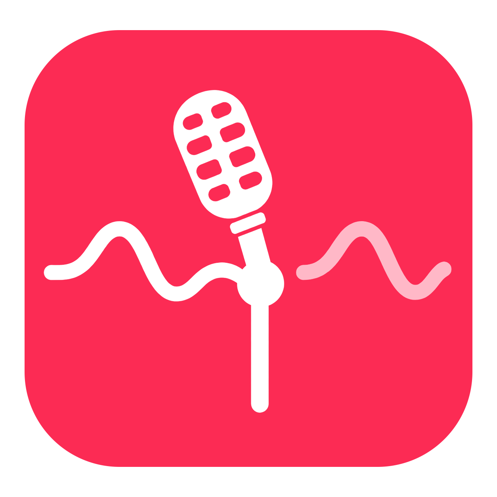

# Choice



**Keep your Bluetooth headphones sounding their best, and give every window the most room Stage Manager allows.**

Choice is a small, open-source macOS menu bar app with two independent fixes for everyday macOS annoyances: microphone selection and Stage Manager window sizing. It was called **Microphone Choice** before version 2.0; see [Upgrading from Microphone Choice](#upgrading-from-microphone-choice).

When a Bluetooth device with a microphone connects for the first time, Choice selects your preferred microphone and asks whether you want to keep it or use the Bluetooth microphone. The default is your Mac's built-in microphone; you can choose a USB microphone or audio interface instead. On later connections, it applies any choice you saved for that device. The app leaves your output device alone.

Check **Remember my choice for this device** in the dialog to use that choice automatically on future connections. The app then shows a notification confirming the saved choice. Click **Change choice** (or the notification itself) to reopen the dialog; uncheck the box and choose a microphone to forget the saved choice. You can also change or forget choices from **Saved devices**, even when notifications are disabled.


## Why I made it

I was tired of connecting my Bluetooth headphones to my Mac and hearing the sound quality drop while listening to music or other content. The headphones sounded fine until their microphone became the input. Many Bluetooth headphones switch from a higher-quality listening mode to a mode designed for two-way audio when their microphone is used. Apple [describes this behavior](https://support.apple.com/en-us/102217) too.

Switching the input back to my Mac's microphone restored the listening experience I wanted, but doing it manually in Sound settings every time was frustrating. I made the app for myself so that choice appears when a headset connects, then added Stage Manager Fill because Apple's Fill covers Stage Manager's recent apps. I'm sharing the source and inviting contributions from anyone with the same problems.

## Install

### Homebrew (recommended)

Requires macOS 13 or newer and [Homebrew](https://brew.sh/). A built-in, USB, or other non-Bluetooth microphone is needed to avoid using a Bluetooth microphone. Homebrew builds the app from this repository's source using Apple's Command Line Tools.

```sh
brew install Mahad871/tap/choice
brew services start choice
```

The service starts when you log in and restarts if the app crashes. You can change **Start at login** in the app's settings. **Quit Choice** stops it for the current session; your login setting is retained. To open it again, use `brew services start choice`.

If macOS asks for Bluetooth access, allow it so the app can recognize headset reconnects reliably. Notifications for remembered choices also need notification permission. To stop or remove it:

```sh
brew services stop choice
brew uninstall choice
```

### Download the app

Download the universal `.zip` from [GitHub Releases](https://github.com/Mahad871/choice/releases), unzip it, move **Choice.app** to Applications, and open it once. The app registers itself as a login item. Manage startup in its settings or **System Settings → General → Login Items & Extensions**. Automatic restart after a crash is provided by the Homebrew service.

The release archive is ad hoc signed and **not Apple notarized**. macOS may block its first launch. If you trust this project and choose to open it, follow [Apple's Open Anyway instructions](https://support.apple.com/en-us/102445). The Homebrew source build avoids this downloaded-app check.

Use one installation method at a time. A single-instance guard prevents two app copies, including an old Microphone Choice, from running at once; opening an already-running app brings up its settings.

### Upgrading from Microphone Choice

Choice keeps the same bundle identifier, so your saved devices, settings, and shortcuts carry over. With Homebrew:

```sh
brew services stop microphone-choice
brew update
brew install Mahad871/tap/choice
brew services start choice
```

Homebrew may migrate the old formula for you during `brew update` or `brew upgrade`. If `brew services list` still shows `microphone-choice`, run `brew services stop microphone-choice` and `brew uninstall microphone-choice`. If you downloaded the app, quit Microphone Choice, delete it from Applications, and open Choice. macOS treats the renamed app as new for Accessibility, so grant it again if you use Stage Manager Fill.

## Menu bar and settings

Click the microphone in the menu bar to see the current input, switch microphones, reopen the Bluetooth microphone dialog, fill a window beside Stage Manager, or open settings.

### Stage Manager Fill

Apple's **Fill** makes a window cover the whole screen, which hides Stage Manager's recent apps. Stage Manager Fill makes the window as large as possible while leaving the strip visible. There are four ways to use it:

- **Green-button menu.** Hover over a window's green button. **Stage Manager Fill** appears as a row directly under Apple's tiling menu, with a preview of where the window will go. Click it to fill.
- **Double-click.** Double-click an empty part of a window's title bar, or the empty part of a sidebar that runs down the window's left side, such as the vertical tab bar in Microsoft Edge or the conversation list in ChatGPT. Double-click again to restore the window's previous size and position. This is on by default.
- **Keyboard shortcut.** Turn on **Keyboard shortcut** in settings to fill the active window with **Control–Option–Command–F** (or a letter of your choice). Press it again to restore.
- **Menu bar.** Choose **Stage Manager Fill** from the menu bar menu, which shows the app it will target.

Choice measures Stage Manager's strip by itself. Whenever the strip is visible, it records how far the thumbnails reach on each display and keeps the window 15 points clear of them, the same gap the thumbnails keep from the screen edge. Until the strip has been seen on a display, it uses an estimate scaled to that display's width. It follows your Stage Manager settings: the strip moves to the right when the Dock is on the left, and no space is kept while **Show recent apps** is off or Stage Manager is off, so Fill then matches Apple's. Choose **Custom width** under **Space for Stage Manager** to set the reserved width yourself, optionally for each display; **Measure again** forgets the measurement.

The double-click recognizes the title row and full-height left sidebars, and leaves buttons, tabs, text fields, rows, links, web pages, and modified clicks to their apps. It replaces the system's double-click only where that already resizes the window: if **Double-click a window's title bar to** is set to **Minimize** or **Do Nothing** in System Settings, title-bar double-clicks keep that behavior, and only sidebars fill. With Stage Manager off and no custom width, Choice leaves title-bar double-clicks to macOS.

Stage Manager Fill moves only that app's standard window. It chooses the display containing the largest part of the window and uses that display's area after the menu bar and Dock. Each fill is checked: Choice writes the frame, waits for the app to settle, and confirms the window stayed put, retrying if the app moved it back. If the app refuses or constrains the size, Choice shows a short message beside the window and puts it back where it was. Minimized, native full-screen, nonstandard, and nonresizable windows are skipped.

Restore positions are remembered separately for up to 128 windows during the current app session. A manual move or resize becomes the starting position for the next fill. The green-button menu and menu bar actions always fill; a later double-click or shortcut can restore their saved position. A restore is refused if its old title bar is no longer reachable on a connected display.

Stage Manager Fill requires **Accessibility** access to read and resize other apps' windows and to recognize what was double-clicked. Its settings show the current access status and include **Open Accessibility Settings…**. The app does not request this access at launch or use it for microphone selection. macOS may require you to grant access again after replacing or rebuilding the app.

| Setting | What it does |
| --- | --- |
| Preferred microphone | Selects the non-Bluetooth input to use for new connections and saved preferred choices. If it is unplugged, the app falls back to the Mac microphone or another available non-Bluetooth input. |
| Appearance | **System** follows your Mac's light or dark theme automatically. **Light** and **Dark** override it for this app. |
| Start at login | Controls startup for your installation method. Turning it off leaves the current session running until you quit. |
| Saved-choice notifications | Turns confirmation notifications on or off. Saved choices continue to apply when notifications are off. |
| Global keyboard shortcut | Opens the choice dialog for a connected Bluetooth microphone, or settings when none is connected. Disabled by default; enable it and choose a letter with modifiers. The default is **Control–Option–Command–M**. An unavailable combination leaves your previous shortcut active. |
| Saved devices | Changes the saved microphone, opens its dialog, or forgets a choice. **Undo forget** restores the most recently forgotten choice. Disconnected devices can be edited for their next connection. |
| Diagnostics | Shows the current input, detected Bluetooth microphones, observed connection times, and why a popup appeared or was skipped. **Test popup** checks the dialog without changing audio or saved choices. **Copy report** copies the local report without device identifiers. |
| Stage Manager Fill | Turns the feature and each way to fill on or off, sets the fill shortcut, chooses automatic or custom space for Stage Manager, and shows Accessibility status. |

Saved preferred choices follow the global preferred-microphone setting. Existing saved Mac-microphone choices are preserved when you upgrade. Switching an input from the menu bar changes the current input without overwriting saved choices.

## What it does

1. Watches Bluetooth connections and Core Audio input devices, with a short periodic check as a fallback.
2. Selects the available preferred microphone while it waits for your answer.
3. Shows a centered dialog with **Use Mac microphone** (or **Use preferred microphone**) highlighted and **Use Bluetooth microphone** as the other choice.
4. Keeps the preferred microphone if you dismiss a first-time dialog or do not answer within 60 seconds. Dismissing an edit dialog leaves the input and saved choice unchanged.
5. Saves a choice only when you check **Remember my choice for this device** and choose a microphone. Saved choices stay on your Mac.

It works with Bluetooth devices that macOS exposes as microphone inputs. It changes the **system default input**, so an app that has its own microphone setting may still need a separate change. It does not change the Bluetooth output, codec, volume, or equalizer. On startup, if a connected Bluetooth microphone is currently the system input, it restores the preferred microphone unless you saved a choice to use that Bluetooth microphone. A device already connected at startup does not produce a new-connection popup; you can reopen the dialog from the menu bar.

On a Mac without an available non-Bluetooth input, the app can still offer the Bluetooth microphone, but cannot provide a separate microphone for higher-quality playback.

The app does not record audio, request microphone capture permission, collect analytics, or send data over the network. It reads Bluetooth connection status and audio device information, then changes the default input. Choices, settings, measured strip widths, and theme overrides are stored in local app preferences. The global shortcuts use macOS hotkey registration and do not require Accessibility permission. With Accessibility access, the green-button menu item watches the pointer's position to notice when it rests on the focused window's green button. The double-click listens for left mouse clicks and checks the clicked Accessibility element only on a second click; it does not monitor keystrokes or save mouse activity. Stage Manager's strip is measured from window positions, which needs no Screen Recording access. Window frames are changed only when you invoke an action. Turning Stage Manager Fill off stops all of its interactions. The diagnostic report stays in memory for the current session; diagnostic messages also go to the process's local standard error log.

## Build from source

On macOS with Apple's Command Line Tools:

```sh
git clone https://github.com/Mahad871/choice.git
cd choice
./scripts/package-release.sh
```

The universal app and ZIP appear in `build/`. The build script compiles both Apple silicon and Intel binaries, generates all macOS icon sizes from the approved artwork, and ad hoc signs the app. Run `build/Choice.app/Contents/MacOS/Choice --probe` to list connected Bluetooth microphones without starting the monitor. `--probe-inputs` lists all microphone names and transports. `--test-prompt` shows a diagnostic dialog and closes it after eight seconds without changing audio or choices.

Run `./scripts/test-connection-tracker.sh` for the connection, saved-choice migration, settings, fallback selection, single-instance, diagnostics, and hotkey registration tests. Run `./scripts/test-stage-manager-fill.sh` for window geometry, strip measurement, saved preferences, green-button menu placement, double-click recognition, frame confirmation, and restore policy tests. Developers can open the built executable with `--preview` for a disposable settings session with sample devices and no audio, login-setting, or external-window changes. Use `--preview-light` or `--preview-dark` with it to check both themes. Keyboard shortcuts in a preview still register with macOS until you disable them or quit.

For the real window animation and restore checks, run `./scripts/test-stage-manager-live.sh` in a desktop session with Accessibility access for your terminal. It opens two disposable test windows, verifies independent fill/restore cycles and repeated Fill commands, then closes them. This opt-in check is separate from headless CI.

## Contributing

Bug reports, documentation improvements, and code contributions are welcome. Please read [CONTRIBUTING.md](CONTRIBUTING.md) before opening a pull request. For a bug, include your macOS version, device model, and what happened when the Bluetooth microphone connected. For a Stage Manager Fill bug, include the app, your display sizes, and your Stage Manager and Dock settings. Please do not post private device identifiers or logs containing sensitive information.

## License

Choice, including its icon, is available under the [MIT License](LICENSE).
